- [C#](#c)
  - [Unions](#unions)
    - [Value type unions](#value-type-unions)
      - [Reason](#reason)
  - [Closed](#closed)
  - [With for object creation with collection expressions](#with-for-object-creation-with-collection-expressions)
  - [Break to specific parts in loops](#break-to-specific-parts-in-loops)
  - [Extension indexer](#extension-indexer)
- [MSBuild](#msbuild)
  - [Cold start](#cold-start)
  - [Warm (incremental) build](#warm-incremental-build)
- [AspNet](#aspnet)
  - [Kestrel](#kestrel)
  - [Signal R](#signal-r)
  - [Json](#json)
  - [Async Validation](#async-validation)
  - [Web workers](#web-workers)
- [MAUI](#maui)
  - [Performance](#performance)
  - [dotnet watch](#dotnet-watch)
  - [MAUI Labs](#maui-labs)
- [Runtime Async](#runtime-async)
- [System.Text.Json](#systemtextjson)
  - [Union types](#union-types)
  - [Closed types](#closed-types)
  - [Prefered way](#prefered-way)
  - [Json converters](#json-converters)
  - [Naming policy](#naming-policy)

# C#
## Unions
Encapsulate multiple types as 1 type:
```csharp
List<Pet> pets = [
    new Dog("Fido"),
    new Cat("Tabby"),
    new Bird { Species = "crow" }
]

union Pet(Dog, Cat, Bird);
```

Nullability is also supported:
`union Pet(Dog, Cat?, Bird)`

As it is a type, it also allows type members (e.g. Methods, properties):
```csharp
union Pet (Dog, Cat?, Bird)
{
    public string Description => this switch
    {
        Dog dog => dog.Name,
        Cat(var adjective) => $"A {adjective} cat",
        Bird {Species: var species} => $"A {species}",
        null => "no description"
    }
}
```

### Value type unions
When making a value type union, the way to write this is a bit different.
You need to use the `[Union]` attribute, and for each type supported within the union a constructor is required.
An object property named  `Value` is required.
It is also possible to inherit the `IUnion` interface which includes the `public object? Value {get; set;}`.
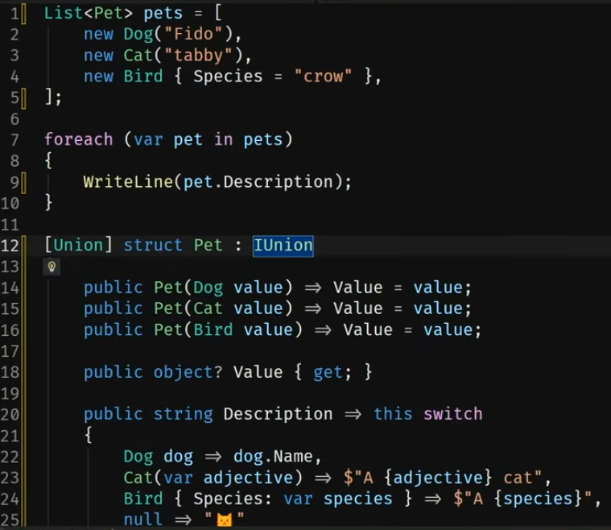

#### Reason
For performance purposes, unions are by default boxed.

## Closed
When using pattern matching you often handle all possible cases for the type. However for a public class which is used as a base class, then handling all use cases is not possible if other assemblies create their inherited variants of the classes.
Using the closed key word makes it possible to inherit within the same assembly, but closed for inheritence for other assemblies.

## With for object creation with collection expressions
It is now possible to create an type using the collection expression while also passing along params:
`HashSet<string> collection = [with(15)]`
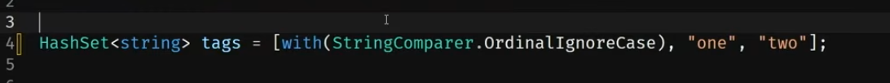

## Break to specific parts in loops
it is now possible to name parts inside a loop, and break towards them (like a `label -> goto`)
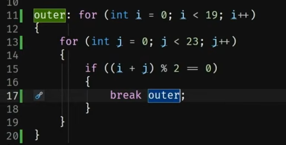

## Extension indexer
It is now possible to create extension methods that supports indexing into collections.
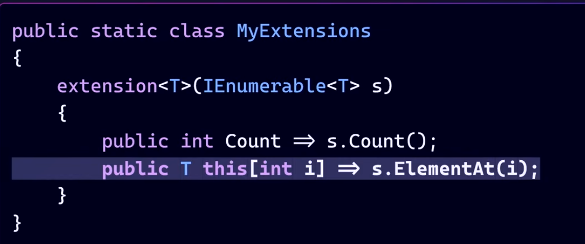

# MSBuild
Using multithreaded MSBuild command `-mt` (which is opt-in for 11.0.100, but will likely be default behaviour for 11.0.200 which is expected to release at `February 2027`) will improve the throughput of the build pipeline.
`dotnet build -mt` 

## Cold start
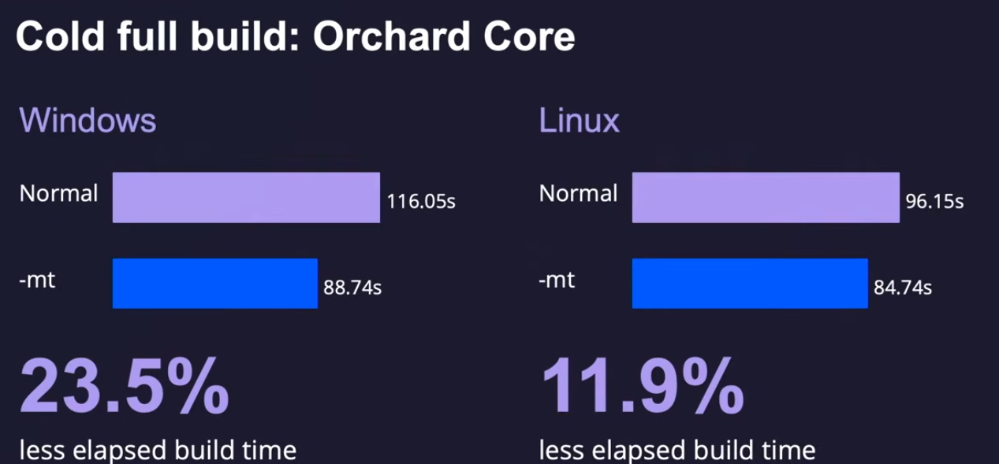

## Warm (incremental) build
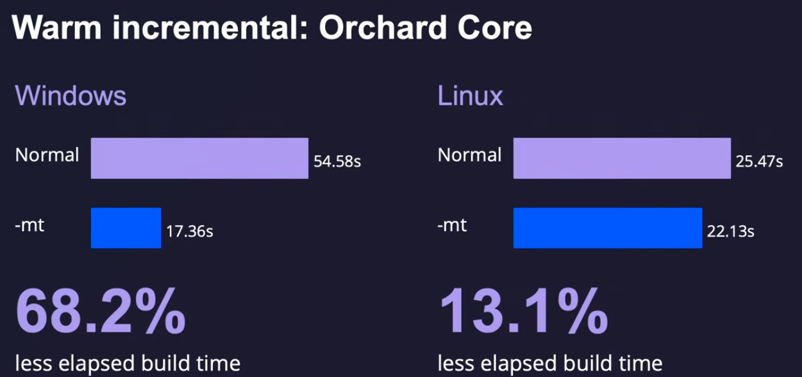


# AspNet

## Kestrel
Performance for bad requests (like malformed requests) is improved by 30%
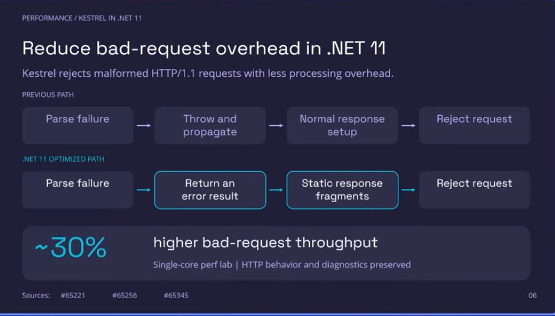

## Signal R
Now possible for SignalR to refresh token if the connection lives longer than the token
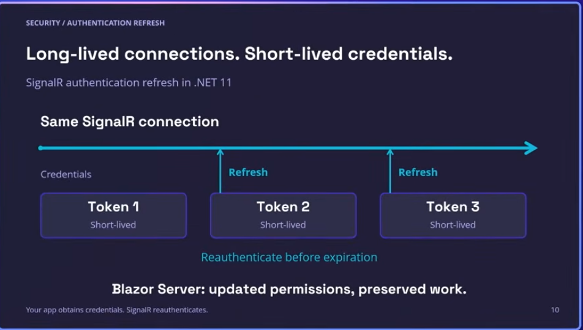
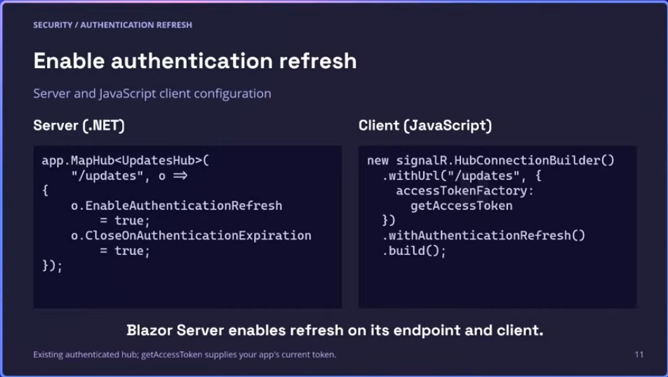

## Json
TODO

## Async Validation
TODO

## Web workers
Now possible to off-load heavy frontend work to web workers.
This will make sure the UI stays responsive while the work is busy.

# MAUI
For .NET 11, targetting Linux is now possible!

## Performance
* Switch to CoreCRL which enables big performance improvements.
* Switch XAML source generation is now using source generators for both DEBUG and RELEASE mode which builds the C# for XAML by compile time instead of at runtime.

## dotnet watch
Dotnet watch now also works when targetting actual devices (not only emulators).

## MAUI Labs
There are multiple exterimental tools or projects that use MAUI in the MAUI labs. This is easy to test/ experiment things for MAUI.

# Runtime Async
Feature aims to improve performance for all asynchronous code, especially when chaining async awaits, and code that returns a Task, but the implementation actually runs synchronous (like MemoryStream.ReadAsync).

With runtime async the compiler no longer generates state machines, but rather lets the JIT generate the implementation whenever it requires it.

This feature aims to reduce the overhead for the amount of async depth frame state machine generations.
Each async await call generates this state machine, but with this no state transfer is generated which means that the JIT compiler now only needs to generate the actual await logic whenever the work needs to be awaited.
Example of this is:
```csharp
await Await(); // Intermediate await, previously added state machine, but no longer

public async Task Await()
{
    await Task.Delay(20); // Only actual awaited call
}
```

As this removes layers of the call-stack, this also reduces the cost for exception bubbling and removes unnecessary allocations:
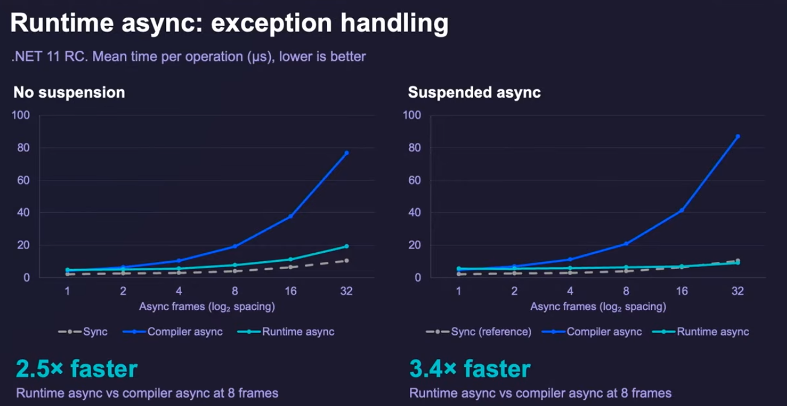
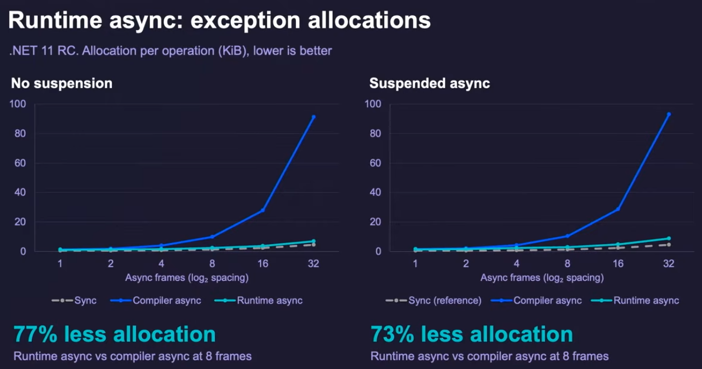
// TODO

# System.Text.Json
## Union types
Supports union types:
```csharp
Either value1 = 200;
JsonSerializer.Serialize(value1); // 200

Either value1 = "ok";
JsonSerializer.Serialize(value2); // "ok"

Either value3 = new Person(Name: "Alice");
JsonSerializer.Serialize(value3); // {"Name": "Alice"}

union Either(int, string, Person);
```

For deserialization it is possible to have multiple different types in an array, then deserialize to an array of the union, it will find the correct type in the union and bind to that.

If the json type for the C# type is the same for multiple types in the union, then it will fail:
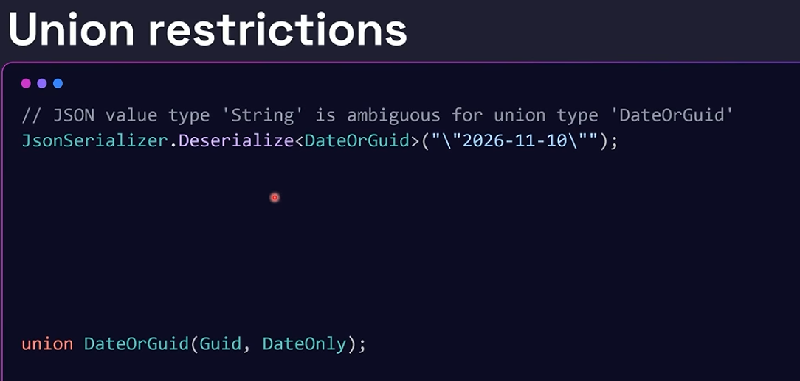

To solve this we have union type classifiers in which the application needs to manage the way it is deserialized manually:
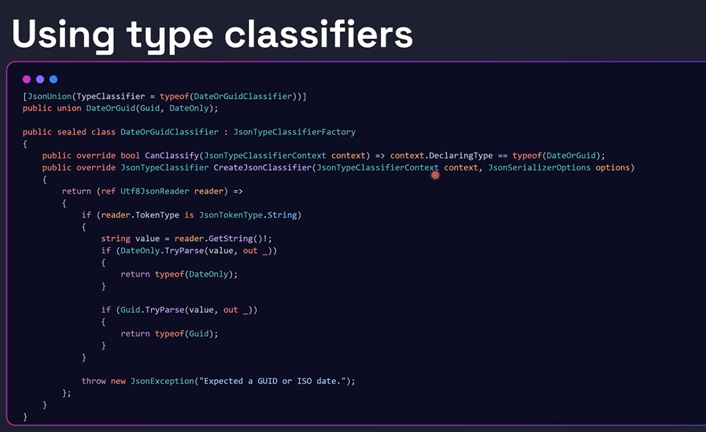

There are existing classifiers which can automatically help based on the structure of the union type:
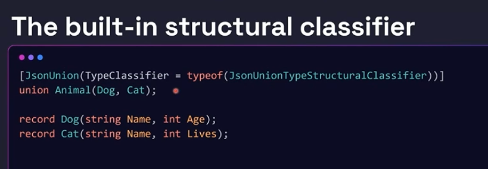
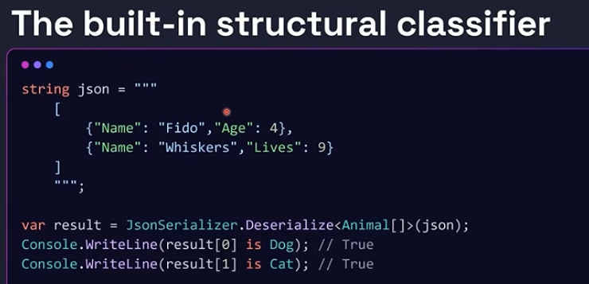

If the properties that are for the separate types omit those properties then it becomes ambigious again and is rejected e.g. `{"Name": "Fido"}`.

## Closed types
When working with a `closed` type the amount of derived types are determined at compile time which removes the need to specify the `JsonDerivedType` for all not annotated types (as the types which are supported are already known).
Simply using the `JsonPolymorphic(InferClosedTypePolymorphism = true)` enables this:
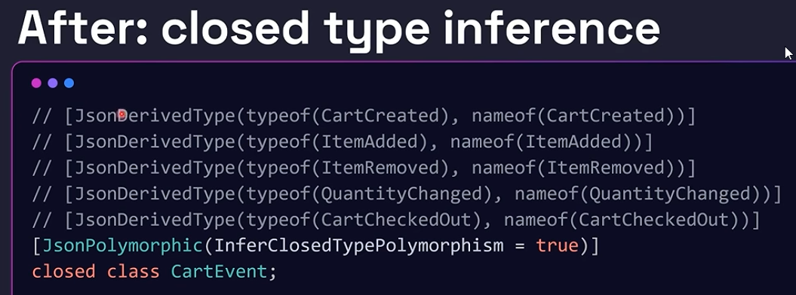

## Prefered way
Prefer closed classes over union types because of guarantees around type properties (via the $type property).
Only use union types if you don't own the schema and the schema specifies it as is.

## Json converters
Now possible to use a generic type converter in json
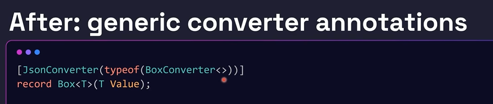

## Naming policy
Now possible to override the policy on property level
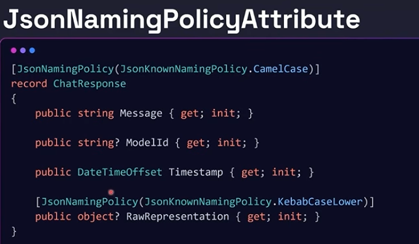